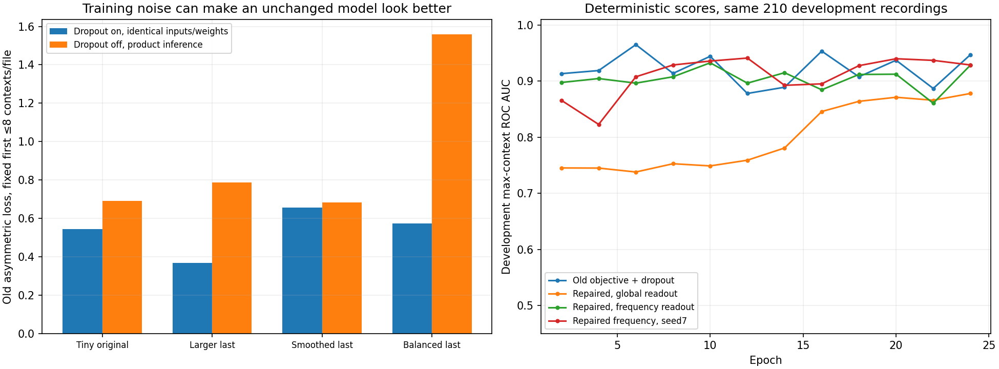
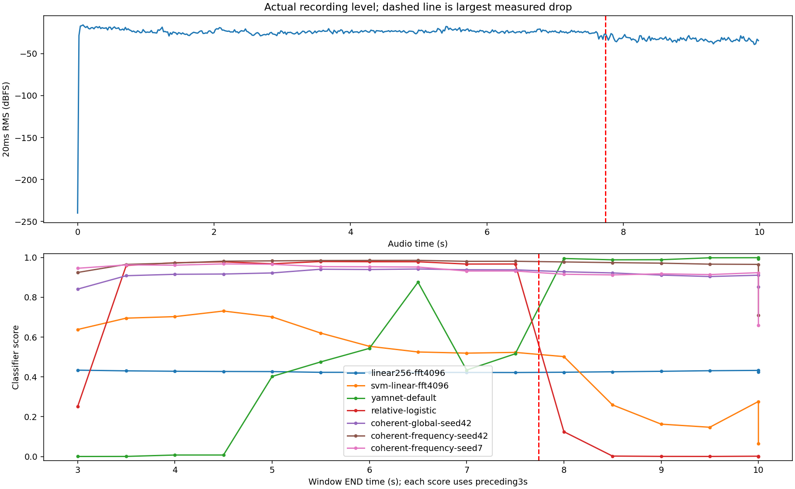
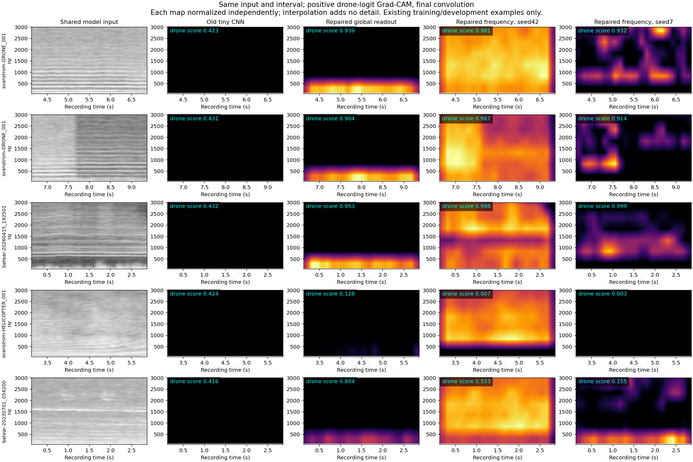

# CNN foundations: a real training defect and controlled repairs

The old positive-max / negative-mean objective rewards input-independent dropout noise. This is a demonstrated defect in this project’s scratch-CNN implementation. It is not a diagnosis of every historical EfficientNet result or proof that this is the only remaining problem.

## Why the old objective can fail

Give both classes exactly the same constant input. A dropout 0.1 feature can produce logit −1 when retained and +1.5 when dropped. A positive bag of 8 gets eight chances to receive the high logit, while the negative loss averages those spikes. Expected balanced loss is 0.566, better than the uninformative 0.693, despite no acoustic/class information. With 60 contexts it falls to 0.328. Turning dropout off yields 0.762. Applying the same maximum-score BCE to both classes removes this counterexample: identical class distributions cannot beat 0.693.

This is not just a toy image observation. On 405 fixed real training bags, the frozen balanced model’s old loss is 0.367±0.017 across 20 dropout draws but 0.788 at inference, without changing its inputs or weights. The larger unbalanced model’s last checkpoint is 0.574±0.081 versus 1.559. The [exact witness and checkpoint audit](mil-objective-audit.json) is separate from accuracy evidence. These fixed-checkpoint comparisons establish mode sensitivity, not sole attribution of the learned optimization trajectory.

## What was trained

Data is unchanged: 405 real training recordings, 55 publisher-positive and 350 negative, 1.912 hours in total. Those positives cover only 6 conservative provenance groups. The same 210 development files contain 22 positives and 188 negatives, 1.908 hours and 4 positive groups. The final assessment audio was not opened. Publisher recording/flight presence is weak supervision; individual windows have not acquired verified audible labels.

All new arms consume exactly the same cached input: mono 16 kHz, 3 seconds, 4096-sample Hann STFT, 256-sample hop, 256 uniform-Hz triangular bands from 50–7600 Hz, relative power with a per-context peak reference, log intensity with an 80 dB floor. Tensor [256,172,1]. There is no shared waveform RMS normalization. Fresh extraction matched all 7,299 train/development cached tensors exactly; 4,648 are training contexts. Reusing them does not add independent data.

Coverage control changes frequency strides from 2/4/4 to 2/3/3, preserving 1,781 parameters and identical initial weights. Every input row now has a computation path. The wider encoder uses 32/64/128 filters with 5×5,3×3,3×3 kernels, ReLU and frequency/time strides(2,2),(3,2),(3,2). It has 93,313 parameters with a linear global-average head.

The matched readout pair shares that encoder and its exact initial convolution weights. Global readout averages frequency/time then applies Dense 473-ReLU→logit: 154,675 parameters. Frequency readout averages time, retains 15 frequency positions, flattens 1920 features then Dense 32-ReLU→logit: 154,689 parameters. They differ by 14 parameters, with different readout function classes. This is one spectrogram input; no 3D or multi-view input was added.

The repaired pair uses binary cross entropy of the SAME maximum context logit for either recording class and disables dropout. Both repairs are bundled; the before/after training comparison does not isolate their separate effects. Per-step sampling is the same cyclic up-to 8 contexts for either class. Each batch has 4 recordings per class, no additional class weights, 51 steps per epoch, 24 epochs, Adam 0.001/clipnorm 1 and convolution L2=1e-4. Validation is deterministic over all cached contexts every 2 epochs; select minimum consistent-max balanced development BCE. Best-at 8, selected-best and last checkpoints are all retained. Fixed seeds reproduce initialization; seed 7 is an explicitly [interim development-triggered replication](replication-trigger.json), not a second test set.

## Full development replay

All 210 development recordings are replayed densely with the same 3 second/.5 second causal contexts, including disclosed tails/silence. Thresholds and 1/2-hit confirmation are selected under the shared 5% negative-recording budget: at most 9/188 alarms. Matching FP counts are calibration constraints, not independent false-alarm measurements. These recordings have been used repeatedly for development; no fresh assessment is claimed.

| Model | Parameters | Selected epoch | TP /22 | FP /188 | Max-score AUC |
| --- | ---: | ---: | ---: | ---: | ---: |
| compact8 | 1,781 | 2 | 11 | 9 | 0.835 |
| coverage8 | 1,781 | 2 | 4 | 9 | 0.826 |
| medium-sampled-max | 93,313 | 12 | 13 | 9 | 0.866 |
| medium-full-smooth | 93,313 | 22 | 12 | 9 | 0.799 |
| medium-balanced-max | 93,313 | 18 | 8 | 9 | 0.775 |
| medium-full-max | 93,313 | 14 | 11 | 9 | 0.858 |
| medium-balanced-global-head | 154,675 | 4 | 12 | 9 | 0.849 |
| medium-balanced-frequency-head | 154,689 | 24 | 18 | 9 | 0.956 |
| coherent-global-seed42 | 154,675 | 24 | 11 | 9 | 0.893 |
| coherent-frequency-seed42 | 154,689 | 10 | 16 | 9 | 0.941 |
| coherent-frequency-seed7 | 154,689 | 12 | 17 | 9 | 0.949 |

## Checkpoint stability on uniform cached contexts

This table uses all cached train/development contexts at the declared 8-epoch snapshot and 24-epoch horizon, evaluated without dropout. It is a different context sampling from dense product replay. The last checkpoint is reported even if worse than the development-selected checkpoint.

| Model | Best-at8 selected epoch / dev AUC | Best-at24 selected epoch / dev AUC | Last24 train AUC | Last24 dev AUC |
| --- | --- | --- | ---: | ---: |
| medium-sampled-max | 2 / 0.735 | 12 / 0.864 | 0.428 | 0.559 |
| medium-full-smooth | 8 / 0.801 | 22 / 0.796 | 0.745 | 0.753 |
| medium-balanced-max | 2 / 0.741 | 18 / 0.765 | 0.726 | 0.843 |
| medium-full-max | 6 / 0.844 | 14 / 0.843 | 0.677 | 0.854 |
| medium-balanced-global-head | 4 / 0.846 | 4 / 0.846 | 0.600 | 0.840 |
| medium-balanced-frequency-head | 6 / 0.965 | 24 / 0.947 | 0.955 | 0.947 |
| coherent-global-seed42 | 2 / 0.745 | 24 / 0.878 | 0.910 | 0.878 |
| coherent-frequency-seed42 | 8 / 0.908 | 10 / 0.933 | 0.985 | 0.928 |
| coherent-frequency-seed7 | 8 / 0.929 | 12 / 0.941 | 0.991 | 0.929 |

Preserved controls on the same development files: original linear 256 CNN 12/22, non-neural SVM 15/22, relative-logistic 18/22, YAMNet+logistic 20/22; all 9/188 negative files alarmed. The new compact 8 repeat reaches 11/22; it is a separately identified training run, not a bitwise recreation of the preserved original 12/22 checkpoint. These are correlated recording counts, not independent flight trials.

## Remaining errors by source

| Model / source | Positive files detected | Negative files alarmed |
| --- | ---: | ---: |
| medium-balanced-frequency-head / batear-field | 7/11 | 2/6 |
| medium-balanced-frequency-head / d3set-ground | 11/11 | 0/0 |
| medium-balanced-frequency-head / d3set-noise | 0/0 | 2/22 |
| medium-balanced-frequency-head / esc10 | 0/0 | 5/160 |
| coherent-global-seed42 / batear-field | 5/11 | 3/6 |
| coherent-global-seed42 / d3set-ground | 6/11 | 0/0 |
| coherent-global-seed42 / d3set-noise | 0/0 | 0/22 |
| coherent-global-seed42 / esc10 | 0/0 | 6/160 |
| coherent-frequency-seed42 / batear-field | 6/11 | 2/6 |
| coherent-frequency-seed42 / d3set-ground | 10/11 | 0/0 |
| coherent-frequency-seed42 / d3set-noise | 0/0 | 2/22 |
| coherent-frequency-seed42 / esc10 | 0/0 | 5/160 |
| coherent-frequency-seed7 / batear-field | 6/11 | 1/6 |
| coherent-frequency-seed7 / d3set-ground | 11/11 | 0/0 |
| coherent-frequency-seed7 / d3set-noise | 0/0 | 1/22 |
| coherent-frequency-seed7 / esc10 | 0/0 | 7/160 |

## Return to the quieter recording and specific contexts

The same Svanstrom DRONE_001 waveform from 4–7 seconds was uniformly attenuated or attenuated only in its second half, with a 10ms taper. These are controlled diagnostic changes to one existing training recording, not extra training audio or independent accuracy trials. Compare each model to itself; scores are not calibrated probabilities.

| Model | Original score | Uniform×0.25 | Second-half×0.25 |
| --- | ---: | ---: | ---: |
| coherent-frequency-seed42 | 0.9808 | 0.9808 | 0.9753 |
| coherent-frequency-seed7 | 0.9320 | 0.9320 | 0.9316 |
| coherent-global-seed42 | 0.9385 | 0.9385 | 0.9023 |
| linear256-fft4096 | 0.4225 | 0.4225 | 0.4295 |
| relative-logistic | 0.9671 | 0.9671 | 0.0469 |
| svm-linear-fft4096 | 0.5195 | 0.5195 | 0.4023 |
| yamnet-default | 0.4344 | 0.0101 | 0.0161 |

The new frequency models remain stable on this particular internal-step control, while YAMNet and relative-logistic change sharply. This is one useful case, not evidence of general gain robustness. The real transition also changes frequency bands unequally, so it is not solely a uniform volume change.

The five-context comparison includes the Svanstrom recording before/across the drop, a Batear FPV recording, helicopter and rural background. The two frequency models separate these particular examples more strongly than the tiny CNN, whose scores remain near 0.42. Seed 7 often concentrates around the 800 Hz region in the drone examples, while seed 42 has much broader maps. Seed 42 also shows a bright normalized positive map for the helicopter despite a drone score near 0.007: positive-only, independently normalized Grad-CAM is not the model score. Spatial gradient averaging can obscure a frequency-sensitive head. These plots do not establish that harmonic relationships were learned or that highlighted regions are causal. Audible event timing remains unverified.

## What this does and does not establish

The repaired frequency readout detects 16/22 positives at seed 42 and 17/22 at seed 7, versus 11/22 for its matched repaired global readout. Under the older loss, the frequency/global pair reaches 18/22 versus 12/22. Preserving frequency positions helps in both comparisons. The objective repair does NOT improve this operating point over the older frequency model: its value is removing a proven training loophole, not a demonstrated standalone alarm-accuracy gain. Both new seeds improve ranking over the tiny baseline, but two seeds cannot characterize run-to-run uncertainty.

The objective defect is concrete; correcting missing frequency paths alone was insufficient. Capacity, readout structure, weak target quality and collection shortcuts remain distinct questions. A source-only rule already predicts 199/210 development labels. Better CNN scores here can still reflect acquisition conditions or other cues. Grad-CAM is a sensitivity diagnostic, not an audible-label or causality check.

The next decisive data task is matched, independently reviewed audible-on/off intervals with entire capture sessions held out, followed by a fresh grouped assessment. Increasing crop counts or repeatedly tuning this development set cannot supply that evidence. The old YAMNet product default and its consumed assessment remain separately identified. The browser lab now offers the new controls beside it, with identical-context Grad-CAM, training histories, retained multi-recording results and original audio playback levels.

## Reproduce and inspect

Plans, training histories, selected/last weights, exact execution source snapshots, instance-selection audits, per-recording source outcomes and compressed full score traces are retained. Raw traces identify trained parents and use placeholder 0.5 decisions; evaluation reports reapply each frozen calibrated decision. No raw audio or feature cache is copied into the artifact package.

`scripts/experiment_cnn_foundations.py`, `scripts/experiment_balanced_cnn.py`, `scripts/experiment_cnn_followup.py` and `scripts/experiment_coherent_cnn.py` execute the declared controls. `scripts/evaluate_cnn_foundations.py` shares dense development frontends and verifies batch/sequential score parity before calibration. `scripts/package_cnn_foundations.py` creates this report and the portable catalog.
