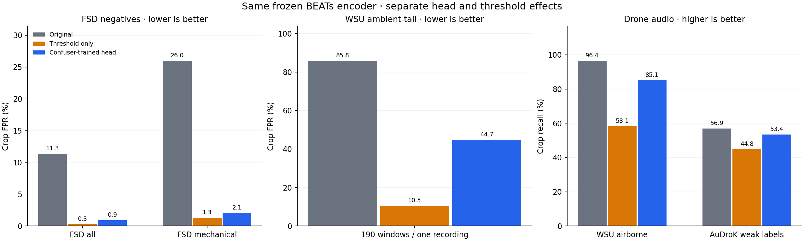

# BEATs mechanical-confuser results

Three frozen comparisons were evaluated on the complete reserved cohort. BEATs remained pretrained and frozen; the third variant trained a new linear classification head.

Accepted fresh crops: **9,665**. Candidate crops: **9,689**. Quality/identity exclusions: **24**. The previous test is development evidence and is excluded from this table.

| Fresh subset | Crops / provenance groups | Original | Threshold only | Confuser-trained head |
|---|---:|---:|---:|---:|
| FSD50K crop false-positive rate | 7,931 / 2,122 | 11.34% | 0.28% | 0.92% |
| FSD mechanical crop false-positive rate | 389 / 256 | 25.96% | 1.29% | 2.06% |
| WSU airborne crop recall | 1,486 / 3 | 96.43% | 58.14% | 85.13% |
| WSU ambient-tail crop false-positive rate | 190 / 1 | 85.79% | 10.53% | 44.74% |
| AuDroK weak-positive crop recall | 58 / 1 | 56.90% | 44.83% | 53.45% |

Lower FPR and higher recall are better. Crop counts do not measure independent field trials.

## What changed

The threshold-only comparison uses the unchanged previous head. The third comparison adds 6,089 UrbanSound8K negative crops to TRAIN, without adding positive training examples. Both new cutoffs follow the same broader-negative calibration rule. Their development operating points are not selected on these fresh recordings.

| Variant | FSD FPR difference vs original | Paired uploader-cluster 95% interval |
|---|---:|---:|
| Threshold only | -11.06 percentage points | -12.23 to -9.98 |
| Confuser-trained head | -10.41 percentage points | -11.53 to -9.39 |

These intervals resample FSD uploader groups, not individual crops. They are conditional on the selected FSD collection. The few field campaigns do not support comparable population intervals.

## Field variation

| WSU flight | Positive / negative crops | Original recall / FPR | Threshold-only recall / FPR | New-head recall / FPR |
|---|---:|---:|---:|---:|
| Mar_18_2025_flight1 | 588 / 0 | 95.75% / — | 59.69% / — | 83.16% / — |
| Mar_18_2025_flight2 | 396 / 190 | 95.71% / 85.79% | 59.09% / 10.53% | 84.60% / 44.74% |
| Nov_25_2024_flight11 | 449 / 0 | 97.77% / — | 56.57% / — | 88.20% / — |
| Oct_11_2024_flight5 | 53 / 0 | 98.11% / — | 47.17% / — | 84.91% / — |

The two March flights share one date/site group. The ambient tail is from one recording; its190 windows are not190 independent negative recordings. AuDroK is one campaign. FSD labels identify human-annotated foreground sounds, not exhaustive drone absence. WSU airborne telemetry establishes physical presence, not audible drone onset/offset. AuDroK recording labels have not been independently verified for the central crops.

## Evidence and reproducibility

The complete cohort and all three numeric heads were frozen before fresh scoring. See [PROTOCOL.md](PROTOCOL.md), [metrics.csv](metrics.csv), [comparison.json](comparison.json), [data-quality.json](data-quality.json), and [error-cases.csv](error-cases.csv). Raw audio is not redistributed. Complete bounded acquisition receipts, the original reservation, canonical manifests and per-crop scores are retained in the local result bundle. The source checksum distinctions are documented in the protocol.

This is a fixed crop-classification comparison. It does not establish operational false alarms per hour, event recall, detection delay, near-human performance, or independence from model pretraining data. The fresh cohort is consumed by this comparison; further tuning requires a separate evaluation design.

