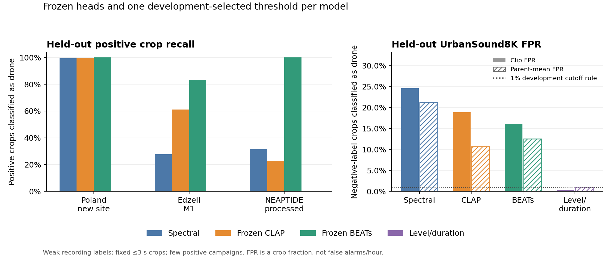

# BEATs improves transfer; mechanical false positives remain

The most valuable result is that a frozen audio representation already contains
useful information for recognizing drones across these public recording sources.
BEATs is the strongest candidate in this bounded comparison. Its remaining
false-positive rate prevents treating it as a reliable detector.

The complete study used 20,573 accepted, prospectively selected crops from the
verified 222-file intake. Training used 9,959 crops, development 1,980, and the final
comparison 8,634. Each eligible native file contributed one central crop of at
most three seconds. This uses 16.620 selected hours from 64.779 native-file hours;
it does not exhaust the long recordings or certify audible-event exposure.
[The complete results](RESULTS.md) retain counts, provenance groups, source terms,
weak-label qualifications, learning curves and all fixed operating points.

## What the results establish

- BEATs detects 360/360 Polish new-site crops, 15/18 Edzell crops and 35/35 processed
  NEAPTIDE crops at its frozen cutoff. The spectral baseline detects 358/360,
  5/18 and 11/35 respectively. CLAP detects 359/360, 11/18 and 8/35.
- Negative transfer remains poor. UrbanSound8K false-positive crops are
  2,024/8,221 for spectral summaries (24.62%), 1,550/8,221 for CLAP (18.85%), and
  1,329/8,221 for BEATs (16.17%). BEATs reduces the baseline count by 34.3%, while
  remaining far above its 0.99% development FPR.
- Drilling, car horns, air conditioners and jackhammers account for 1,090 of the
  1,329 BEATs false positives (82.0%). Drilling FPR is 51.6%; car-horn FPR is 42.4%.
  These are concrete confuser categories for the next training study.
- The parent-mean Urban FPR is 12.56% for BEATs and 10.68% for CLAP. CLAP performs
  better on this particular negative statistic, while losing much more positive
  recall on the external sources. BEATs does not dominate every metric.
- BEATs paired-source AUC is 0.9999 for Polish positives, 0.9212 for Edzell, and
  0.9963 for NEAPTIDE, each paired with the same held-out negatives. This shows
  stronger score ranking than the baseline, without establishing that a simple
  threshold change will solve the confuser problem.

All models perform very well on the Polish new-site holdout, including the
spectral baseline. That result alone would conceal the much weaker transfer to
other source collections. The test set is 95.2% negative-label crops, so an
always-negative rule would also obtain 95.2% clip accuracy while detecting no
drones. The useful comparison is the joint recall/FPR behavior.

The level/duration control detects none of the final positives at its frozen
cutoff. Simple level/duration features do not reproduce the useful detector
behavior here. This does not establish which cues the richer models use or rule
out source-specific nuisance cues.

All three BEATs false negatives share the Edzell filename configuration prefix
`Ed_M3_10_F15_N_E_dw`. That is a specific cluster for later configuration and
actual-crop audibility review. The filename alone does not establish the cause.
The [error export](error-review.csv) identifies all cases where any model differs
from the weak publisher label, with source filenames, raw logits and decisions.

## The next milestone

**Keep BEATs as the fixed representation and improve rejection of mechanical
confusers through training and calibration data.** This is more directly supported
by the observed errors than another architecture, FFT, window-duration or PCEN
search. Broadly pretrained features have earned further work; operational
reliability has not been established.

1. **Reserve a new evaluation cohort before changing the model.** The present
   final cohort is consumed. Use parent-overlap checks and whole capture groups.
   Previously identified public candidates include unscored AuDroK physical
   point-microphone recordings and unused original background/confuser sources,
   including RealMAN where its content and annotations support the intended
   claim. Confirm mechanical-confuser coverage and label strength before
   calling a candidate a suitable test set. Do not count microphone views as
   separate captures or assume that environmental labels certify every second
   of drone absence.
2. **Use the current UrbanSound8K material for training/development.** Keep its
   Freesound parents together. Include the full relevant confuser classes,
   with source/parent balancing, rather than selecting only the 1,329 errors.
   Keep the original positive training pool fixed for the first comparison so
   the effect of negative-data coverage can be assessed.
3. **Run three prespecified variants on the same BEATs features:** the existing
   frozen head/cutoff; that head with one global cutoff selected from broader
   development negatives; and a head retrained with the additional negatives,
   using the same broader calibration rule. Keep C, frontend and crop policy
   fixed initially. Report recall and clip FPR by source and negative class,
   including parent-mean FPR. Freeze all choices before the new evaluation.
   This separates calibration changes from improved class discrimination.
4. **Make the next decision from that independent comparison.** Seek materially
   lower confuser FPR while preserving new-campaign positive recall. If those
   gains transfer, proceed to labelled continuous-recording evaluation, including
   alarm episodes, occupancy and detection delay. If they do not, examine
   audibility/label support and consider bounded adaptation of the pretrained
   backbone. More crops of the same captures do not establish that the missing
   coverage has been supplied.

The existing feature caches make the head/calibration comparison inexpensive.
Acquisition and genuinely independent evaluation coverage remain the main new
work. No particular training-hour quota follows from this study.

## What remains uncertain

The positive final sources each cover one campaign/date; NEAPTIDE is processed
measurement audio. Crop labels are inherited from publisher recording labels,
not independent audible-event annotations. Source and class remain partly
confounded in training. Historical ESC-50/Urban parent overlap was quarantined
before final use; shifted/lossy copies and encoder-pretraining overlap are not
fully ruled out. Native frontends differ between methods, and the result is
conditional on a fixed C=1 linear probe, not every possible fine-tuned model.

The completed CPU experiment, exact code pin and saved model/feature identities
are documented in the [handoff](HANDOFF.md). The result supports a useful next
research direction without claiming near-human recognition or acceptable
continuous-monitoring false alarms.
