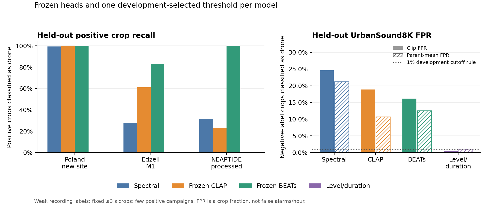

# Public-corpus frozen-representation comparison

This is an executed comparison of fresh linear classifiers on real public audio. Every eligible file contributes a prospectively fixed central crop of at most three seconds. The result measures transfer of weak recording labels to these crops. It does not measure continuous-stream event recall, false alarms per hour, alarm occupancy, or detection delay.

**20,573 accepted crops**, 16.620 selected crop-hours, from 64.779 summed native-file hours. These hour totals are not independent drone-audible or drone-absent exposure.

[Interpretation and the next milestone](FINDINGS.md).

## Cohort and partition

| Release / partition | Crops | Provenance groups | Native-file h | Selected crop h | Documented crop-interval union h |
|---|---:|---:|---:|---:|---:|
| dnc / train | 4,357 | 1 | 17.722 | 3.618 | not established |
| dronenoise-edzell-v3 / final | 18 | 1 | 0.108 | 0.015 | not established |
| idmt-berne-2022 / train | 163 | 1 | 1.358 | 0.136 | not established |
| neaptide-v1 / final | 35 | 1 | 0.042 | 0.022 | not established |
| poland-uav-v1 / development | 360 | 1 | 4.734 | 0.300 | not established |
| poland-uav-v1 / final | 360 | 1 | 4.526 | 0.300 | not established |
| poland-uav-v1 / train | 813 | 3 | 10.642 | 0.677 | not established |
| tut2017-development / train | 4,626 | 248 | 12.850 | 3.855 | 3.855 |
| tut2017-evaluation / development | 1,620 | 109 | 4.500 | 1.350 | 1.350 |
| urbansound8k / final | 8,221 | 1191 | 8.296 | 6.347 | 3.254 |

TRAIN uses three Polish capture dates, the single Berne campaign, TUT2017 development and DNC. DEVELOPMENT uses a fourth Polish date and TUT2017 evaluation. FINAL uses the fifth Polish date at a new site, Edzell DroneNoise, processed NEAPTIDE measurements, and UrbanSound8K. Simultaneous microphones are not counted as independent examples: channel 0 is used for multichannel WAVs, microphone M1 for DroneNoise, and microphone 1 for NEAPTIDE. DNC has unresolved session provenance and is conservatively one group.

The final positive sources each represent one campaign/date; thousands of files cannot turn them into thousands of independent domain-transfer trials. Source and class remain partly confounded. Positive crops inherit publisher drone-recording labels without independent audibility timing. Polish speech-plus-drone files remain positive. General sound-class labels do not certify exhaustive drone absence. NEAPTIDE is a processed measurement stress set, not unmodified field audio.

Quality finalization made 520 additional exclusions for publisher fault intervals, verified duplicates, or historical parent overlap. UrbanSound8K parents shared with the project's earlier ESC-50 material are quarantined before final scoring. Shared parent identity does not assert identical selected excerpts. Source acquisition checks publisher checksums, stored SHA-256, and selected ZIP-member CRC. TUT original IDs are disjoint across releases. Shifted/lossy cross-source copies and overlap in encoder pretraining have not been ruled out.

## Frozen held-out results

Every head uses weighted TRAIN-only standardization and logistic regression with fixed C=1. Weight mass is balanced by class, source, capture group and then rows. One raw-logit cutoff per model is chosen from DEVELOPMENT negatives at empirical clip FPR ≤1%, then retained for every final source. No final-source threshold is fitted. Sigmoid values are display scores, not calibrated field probabilities.

| Model | Polish new-site recall | Edzell recall | NEAPTIDE recall | Urban clip FPR | Urban parent-mean FPR | Macro-source balanced accuracy |
|---|---:|---:|---:|---:|---:|---:|
| Spectral summaries | 99.44% | 27.78% | 31.43% | 24.62% | 21.21% | 64.13% |
| Frozen CLAP | 99.72% | 61.11% | 22.86% | 18.85% | 10.68% | 71.19% |
| Frozen BEATs | 100.00% | 83.33% | 100.00% | 16.17% | 12.56% | 89.14% |
| Level/duration control | 0.00% | 0.00% | 0.00% | 0.40% | 1.08% | 49.80% |

Macro-source balanced accuracy gives equal weight to the three positive-source recalls, then balances that mean against negative-source specificity. The pooled score is retained in JSON but does not let the large UrbanSound8K excerpt count dominate the comparison.
Urban parent-mean FPR averages each original recording's crop-level FPR with equal weight, so parents supplying many overlapping excerpts do not receive more mass. This also remains a crop statistic, rather than an alarm-episode rate.

AUC distinguishes score ranking from the behavior of the development-selected cutoff. Each row below pairs one final positive source with the same held-out UrbanSound8K negative set; these rows share negatives and are not independent experiments.

| Model | Polish + Urban AUC | Edzell + Urban AUC | NEAPTIDE + Urban AUC |
|---|---:|---:|---:|
| Spectral summaries | 0.9499 | 0.5278 | 0.3706 |
| Frozen CLAP | 0.9972 | 0.7948 | 0.5568 |
| Frozen BEATs | 0.9999 | 0.9212 | 0.9963 |
| Level/duration control | 0.8443 | 0.3119 | 0.1465 |

## False positives by published negative class

| UrbanSound8K class | Spectral FPR | CLAP FPR | BEATs FPR | Level/duration FPR |
|---|---:|---:|---:|---:|
| air_conditioner | 25.30% | 21.90% | 24.50% | 0.00% |
| car_horn | 37.17% | 29.28% | 42.43% | 0.00% |
| children_playing | 8.00% | 3.30% | 3.20% | 0.10% |
| dog_bark | 20.65% | 1.91% | 4.60% | 3.37% |
| drilling | 43.00% | 27.70% | 51.60% | 0.00% |
| engine_idling | 29.77% | 31.31% | 7.09% | 0.00% |
| gun_shot | 2.16% | 16.71% | 0.27% | 0.54% |
| jackhammer | 46.60% | 54.20% | 20.00% | 0.00% |
| siren | 12.97% | 5.12% | 7.28% | 0.00% |
| street_music | 14.50% | 2.30% | 4.60% | 0.00% |

## Polish measurement conditions

These are subdivisions of the same final capture date, not additional independent domains. Speech markers come from publisher filenames; they do not constitute a new audibility annotation. All decisions below use the frozen global cutoffs.

| Condition | Crops | Spectral recall | CLAP recall | BEATs recall | Level/duration recall |
|---|---:|---:|---:|---:|---:|
| Publisher speech marker | 181 | 100.00% | 100.00% | 100.00% | 0.00% |
| Without speech marker | 179 | 98.88% | 99.44% | 100.00% | 0.00% |
| D14 | 90 | 100.00% | 100.00% | 100.00% | 0.00% |
| D15 | 90 | 100.00% | 98.89% | 100.00% | 0.00% |
| D16 | 90 | 98.89% | 100.00% | 100.00% | 0.00% |
| D17 | 90 | 98.89% | 100.00% | 100.00% | 0.00% |

## Development-only grouped learning curves

These fits use 25%, 50% and 100% of available groups within each training source. Partial fits repeat group selection with seeds 17, 43 and 91. Single-group sources remain present at every size; this is not an estimate of a universal required training-hour count. No final examples choose these subsets or their cutoffs.

| Model | Requested group fraction | Fits | Training groups | Training clips range | Development recall mean (range) |
|---|---:|---:|---:|---:|---:|
| Spectral summaries | 25% | 3 | 65–65 | 5,840–6,052 | 79.17% (69.44%–89.44%) |
| Spectral summaries | 50% | 3 | 128–128 | 7,352–7,500 | 92.50% (90.83%–94.72%) |
| Spectral summaries | 100% | 1 | 253–253 | 9,959–9,959 | 94.72% (94.72%–94.72%) |
| Frozen CLAP | 25% | 3 | 65–65 | 5,840–6,052 | 96.39% (93.89%–98.33%) |
| Frozen CLAP | 50% | 3 | 128–128 | 7,352–7,500 | 99.54% (99.17%–99.72%) |
| Frozen CLAP | 100% | 1 | 253–253 | 9,959–9,959 | 99.72% (99.72%–99.72%) |
| Frozen BEATs | 25% | 3 | 65–65 | 5,840–6,052 | 99.63% (99.44%–99.72%) |
| Frozen BEATs | 50% | 3 | 128–128 | 7,352–7,500 | 99.72% (99.72%–99.72%) |
| Frozen BEATs | 100% | 1 | 253–253 | 9,959–9,959 | 99.72% (99.72%–99.72%) |
| Level/duration control | 25% | 3 | 65–65 | 5,840–6,052 | 0.00% (0.00%–0.00%) |
| Level/duration control | 50% | 3 | 128–128 | 7,352–7,500 | 0.00% (0.00%–0.00%) |
| Level/duration control | 100% | 1 | 253–253 | 9,959–9,959 | 0.00% (0.00%–0.00%) |

## Interpretation limits and next use

The primary comparison is pretrained representations versus a fresh spectral head on the same corpus. The nuisance control asks how much simple level/duration cues can predict across this partition; it does not establish a causal explanation. A lower false-positive rate with weaker recall, or higher recall with widespread false positives, is not automatically an improvement. Inspect the full per-source table and paired AUCs.

All four prespecified models were evaluated together after their heads and thresholds were frozen. This final cohort is now consumed. Tuning to these results requires a different independent evaluation cohort for a new generalization claim. Conditional clip metrics are reported without confidence intervals that pretend correlated files are independent campaigns. A useful operational detector still needs matched field backgrounds and temporal annotations supporting audible-event and false-alarm claims.

## Reproduction and evidence

- Final manifest SHA-256: `174a0caf901ca638e7783b679d97c5d6c5529c4eb87e25987c8267f760246b4b`
- Frozen models SHA-256: `c6381b9854ddc7f981b00f9ad282b34c618faeb89c49934eda9da72a3e41ff7b`
- Comparison SHA-256: `aa16c548b018022ce9eb32df9ff42e2deebb8471ea92a82a3c65655d198ad5a0`
- Encoder checkpoint, frontend, package, code and feature identities are in the machine-readable receipts.
- `scripts/run_corpus_milestone.py` executes preparation, quality finalization, frozen fitting and one final evaluation.
- `scripts/report_corpus_study.py` generates this report from saved results without refitting or rescoring audio.
- Source licenses remain per release; this report does not redistribute the audio or change its terms.
