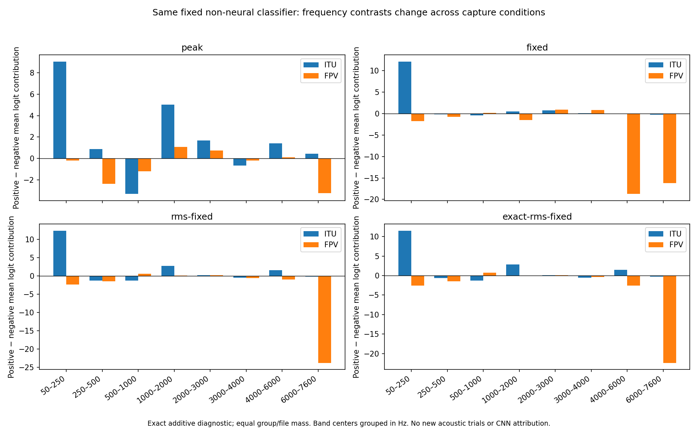

# Transfer after the within-session learning control

The repaired scratch CNN can learn the original published labels, but that
does not establish a transferable drone criterion. Carrying the same twelve
packages into other recording conditions exposes many false positives.
RMS normalization improves some positive detections while leaving this
discrimination problem unresolved. No model or threshold is promoted.

## Fixed comparison

All models were trained earlier on the same single ITU session. Eight CNNs
(two seeds per amplitude rule) and four matched mean/std-descriptor logistic
controls retain their numeric weights, preprocessing and 0.5 thresholds.
The original training audit, seeds, targets and validation selection are
documented in [the learning study](../learnability-normalization-v1/RESULTS.md).

For this transfer diagnosis, use complete one-second contexts at 0.5s steps,
at most 60 uniformly sampled contexts per recording including endpoints.
A file is positive if any sampled score reaches 0.5. This is a classification
probe, not the product's three-second/two-hit alarm. Positive file labels
do not label each sampled second. Differing duration and context count
affect max-score comparisons. No event recall or false alarms/hour follows.

## Other previously consumed sources

The 652-file cohort comprises 615 old train/development recordings and all 37
FPV source recordings assessed earlier. These are new conditions for the
one-second ITU-trained classifiers, but they are consumed project data.
The old recordings are not held out from the project's earlier detectors.
All source-separated counts and individual decisions remain in the JSON.

| Input rule / model | FPV TP /21 | FPV FP /16 | FPV max-score AUC | Svanström TP /30 | Svanström FP /60 |
| --- | ---: | ---: | ---: | ---: | ---: |
| peak-seed42 | 16 | 12 | 0.533 | 15 | 29 |
| peak-seed7 | 21 | 13 | 0.664 | 19 | 31 |
| peak-logistic | 2 | 10 | 0.116 | 10 | 11 |
| fixed-seed42 | 19 | 15 | 0.372 | 22 | 46 |
| fixed-seed7 | 20 | 16 | 0.551 | 28 | 53 |
| fixed-logistic | 20 | 16 | 0.432 | 19 | 51 |
| rms-fixed-seed42 | 20 | 16 | 0.405 | 23 | 41 |
| rms-fixed-seed7 | 21 | 16 | 0.390 | 30 | 44 |
| rms-fixed-logistic | 20 | 16 | 0.249 | 17 | 53 |
| exact-rms-fixed-seed42 | 21 | 16 | 0.512 | 27 | 39 |
| exact-rms-fixed-seed7 | 21 | 16 | 0.427 | 30 | 39 |
| exact-rms-fixed-logistic | 20 | 16 | 0.222 | 16 | 49 |

Both exact-RMS CNNs detect every FPV positive and classify every FPV
negative as positive. This cannot support choosing RMS as a better detector.
The low FPV ranking AUCs also show why moving a threshold alone is not a
sufficient explanation for these particular classifiers. Neither the
positive nor negative FPV file counts are independent capture-session counts;
session provenance is undocumented, so this source remains one conservative
component. Earlier three-second CNN weights and their different training
target are assessed separately in the prior external report.

For the two exact-RMS CNNs, negative-labelled FPV files have mean sampled
score-positive fractions of 79.6% and 77.3% (equal file mass). The false
positives therefore persist through much of these recordings; taking a
maximum over many opportunities does not explain the whole failure.

## Fresh positive-only recording condition

Before downloading or scoring, the panel and the exact five primary-human
Drone rows from the Kenya Forest Sounds spreadsheet were pinned. Original
Git blob hashes, the repository revision and primary label column were
checked. Secondary comments containing Drone do not become primary labels.
All five excerpts have the apparent original prefix ZOOM0071: 24.985s in
total and one conservative capture group, not five independent trials.
Other dominant-sound labels do not certify audible drone absence, so no
negatives were invented from the rest of this collection.

| Input rule / model | Human-primary positive clips detected /5 |
| --- | ---: |
| peak-seed42 | 1 |
| peak-seed7 | 3 |
| peak-logistic | 0 |
| fixed-seed42 | 1 |
| fixed-seed7 | 1 |
| fixed-logistic | 3 |
| rms-fixed-seed42 | 5 |
| rms-fixed-seed7 | 5 |
| rms-fixed-logistic | 4 |
| exact-rms-fixed-seed42 | 5 |
| exact-rms-fixed-seed7 | 5 |
| exact-rms-fixed-logistic | 4 |

The two bounded-RMS CNNs and two exact-RMS CNNs detect all five clips.
This is useful positive coverage evidence and has no false-positive estimate.
Original-policy legacy results are separate:

- coherent-frequency-seed42: 3/5, using its original three-second replay and alarm policy.
- coherent-frequency-seed7: 2/5, using its original three-second replay and alarm policy.
- svm-linear-fft4096: 0/5, using its original three-second replay and alarm policy.
- yamnet-default: 3/5, using its original three-second replay and alarm policy.

These clips are now consumed for future development. No precision, specificity,
range, five-flight generalization or onset/duration claim is supported.

## Which non-neural distinctions transfer?

An exact additive decomposition explains the logistic controls without
turning a heatmap into a causal story. For each fixed package, average each
descriptor within its publisher group/file, then average groups equally
within each class. Decompose the positive-minus-negative mean logit using
the actual train-only standardizer and coefficients. Intercept and mean
offset cancel. The result is not the max-over-context decision statistic.

| Amplitude rule | ITU test mean-logit contrast | FPV mean-logit contrast |
| --- | ---: | ---: |
| exact-rms-fixed | 13.196 | -28.567 |
| fixed | 12.593 | -37.031 |
| peak | 14.416 | -5.302 |
| rms-fixed | 13.470 | -28.461 |

The learned aggregate class contrast reverses under every amplitude rule.
At fixed/RMS references, 6–7.6kHz contributes strongly to the reversal;
the strong 50–250Hz positive distinction in ITU also fails to carry over.
These are broad frequency mean/variation statistics. They do not identify
audible rotor harmonics or prove why a CNN fires. The 512 retained terms
make the non-neural calculation inspectable. Good same-session learning
alone cannot validate the physical meaning of those distinctions.

## Reproducing quieter-input sensitivity

A disclosed follow-up probes 18 fixed contexts from the already consumed
FPV cases, all five Kenya clips, and the first ITU test segment of each
class. Original and middle contexts are retained where distinct. These
are selected diagnostic inputs, not 18 independent trials. The source
under fresh assessment is excluded. All twelve classifiers and all
transformations are retained, including raw logits before the sigmoid.

Multiplying the whole waveform by 0.25 (about −12dB) gives:

| CNN input rule | Seed42 threshold flips /18 | Seed7 threshold flips /18 |
| --- | ---: | ---: |
| peak | 0 | 0 |
| fixed | 3 | 3 |
| rms-fixed | 4 | 2 |
| exact-rms-fixed | 0 | 0 |

Peak-relative and exact-RMS preprocessing cancel a uniform gain here.
A fixed power reference retains it. Bounded RMS does not guarantee a
shared level: quieter inputs can hit its gain ceiling, and peak limits
also constrain the attainable RMS. The caps explain why this rule can
still change a classification sharply when the same input is quieter.
Exact numerical normalization removes that sensitivity; it does not fix
the FPV false positives or improve the physical signal-to-noise ratio.

Time-mean replacement and ten shared/independent band-time permutations
also remain available. Independent permutations produce nonzero CNN
logit changes even when a saturated probability barely moves. The
decision stays unchanged in most of these selected cases, but the
networks are not globally invariant. Stationary hovering can also have
valid static cues: these nonphysical probes neither prove a correct
drone criterion nor establish that temporal motion must be required.

## Fresh controlled-capture source with explicit backgrounds

A separate release provides 200 hovering DJI Flip recordings, 28 explicit
field backgrounds and 45 loudspeaker replays. All 273 main recordings
were selected before audio scoring, using channel0 only. The source was
discovered after the Kenya/FPV outcomes; all twelve earlier packages and
thresholds were retained without selecting winners. All other channels
and calibration data were excluded. No published benchmark code ran.

The retained single-channel audio totals 7.221h.
Original selected WAV/JSON member SHA-256 and ZIP CRC checks passed.
The stored FLACs decode bit-for-bit to the original 48kHz 16-bit PCM.
Only selected members were downloaded, so the 20.35GB archive MD5 is
recorded but not claimed verified. Source metadata and citation are retained.

| Input rule / model | Field TP /200 | Field FP /28 | Field max-score AUC | Controlled replay FP /45 |
| --- | ---: | ---: | ---: | ---: |
| peak-seed42 | 154 | 20 | 0.639 | 11 |
| peak-seed7 | 164 | 19 | 0.702 | 15 |
| peak-logistic | 78 | 15 | 0.454 | 0 |
| fixed-seed42 | 118 | 23 | 0.493 | 0 |
| fixed-seed7 | 151 | 23 | 0.524 | 5 |
| fixed-logistic | 117 | 14 | 0.547 | 2 |
| rms-fixed-seed42 | 199 | 25 | 0.663 | 44 |
| rms-fixed-seed7 | 200 | 23 | 0.652 | 44 |
| rms-fixed-logistic | 170 | 24 | 0.550 | 25 |
| exact-rms-fixed-seed42 | 185 | 21 | 0.645 | 38 |
| exact-rms-fixed-seed7 | 192 | 23 | 0.588 | 38 |
| exact-rms-fixed-logistic | 189 | 27 | 0.449 | 41 |

Bounded-RMS CNNs detect 199/200 and 200/200 positives but also classify
25/28 and 23/28 field backgrounds as positive, plus 44/45 replays each.
No rule establishes a reliable detector. The large positive coverage
gain cannot be read without its background cost.

The field and replay negatives are deliberately reported separately.
One microphone per physical recording avoids treating 16 channels as
independent evidence. Many publisher session IDs are per-recording
placeholders. The session table explicitly marks historical dates
unavailable for all 200 positives and 12 backgrounds, despite date-like
IDs elsewhere. A metadata-only amendment frozen before inference pools
those 212 captures together; the remaining 61 share two dated October
sessions. These three metadata components do not establish statistical
independence. The site, array and drone family remain shared. Class and acquisition
condition are therefore still entangled. Spatial labels come from
capture geometry; positive event extents come from experimental design,
not human-reviewed audible boundaries. This is recording-level external
coverage, not a validated range curve or continuous-event benchmark.

## Consequence for the next experiment

Do not expand the CNN or add a richer tensor to explain these results.
The next training comparison needs varied capture conditions with both
classes represented within each condition, a source/group holdout fixed
before fitting, and the same neural/non-neural controls. Inspect matched
positive/background/machinery examples to decide whether harmonic spacing
and coordinated motion distinguish the cases. Check those distinctions
directly against broad-spectrum controls before encoding more complexity.
A feature proposal must earn its place through that discrimination test.

All inspected cohorts are now consumed. Repeating their windows, changing
thresholds on them or splitting their channels does not create a fresh test.
No architecture, deployed model, public site or product default was changed.
