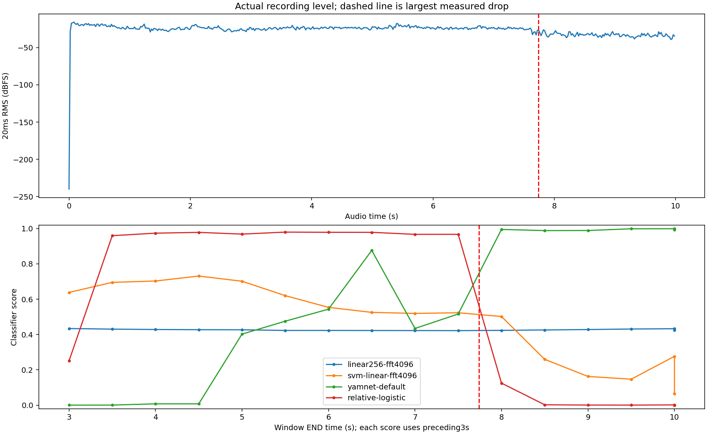

# The quieter transition and the model jumps

The user's screenshot pattern matches Svanstrom DRONE_001: near a window ending5s the CNN score is.4269, YAMNet-based score about.4024, SVM.7017 and relative-logistic.9685; at a window ending9.5s they are.4312,.9986,.1472 and.0005. Small browser/export differences account for the last displayed decimals. This is one existing training recording, not a new detection trial. The user supplied the listening observation; the analysis here measures the waveform and controlled changes, without claiming independent listening verification.

The largest measured median20ms-RMS drop occurs near **7.74s**, about **5.65dB** across adjacent240ms intervals. Equal two-second excerpts immediately before/after have RMS.06334 and.02473. Their spectral balance also changes: mean band powers fall by approximately3.9dB below100Hz,10.8dB at100–500Hz,9.8dB at500–1500Hz,13.8dB at1500–4000Hz and15.2dB at4000–8000Hz. The actual pre/post comparison is therefore not a controlled uniform gain change; it can include changed background or source components. These measurements are not an independently estimated acoustic SNR.

## Change only the amplitude rule on the same real segment

All gain controls use the exact same three-second waveform from4–7s. Uniform attenuation adds no noise and does not clip. The internal-step control attenuates the second half by a factor.25 with a10ms taper to avoid adding a click. The names “minus12dB” denote factor.25, actually minus12.041dB. The factor.1 control is minus20dB. No altered waveform is used for training or field-accuracy evidence.

| Detector | Original segment | Uniform ×.25 | Uniform ×.1 | Second half ×.25 |
| --- | ---: | ---: | ---: | ---: |
| linear256 CNN | .4225 | .4225 | .4225 | .4295 |
| RBF SVM | .5195 | .5195 | .5195 | .4023 |
| YAMNet encoder + project logistic head | .4344 | .0101 | .0000071 | .0161 |
| Relative-logistic | .9671 | .9671 | .9671 | .0469 |

The YAMNet-based detector has a demonstrated sensitivity to uniform digital gain on this segment. This test concerns the entire encoder-plus-trained-head pipeline and does not isolate a defective layer or prove a wrong acoustic label. The relative baselines cancel a constant gain over a whole window, yet retain changes within it. The large relative-logistic jump can therefore occur without changing the underlying frequency components: its temporal log-mel statistics change. The small CNN's nearly flat response is not evidence of correct gain robustness or useful recognition; its training fit and structural limitations are separately documented.

An extra control applies the same available-context RMS target.05, gain ceiling20dB and peak ceiling.98 before the unchanged detector. For the YAMNet-based detector, both the original and uniformly attenuated signals then score **.1731**, while the internal-step signal scores **.0136**. This confirms that a common RMS reference removes uniform-gain sensitivity for this non-capped pair without changing the classifier weights. It does not establish that this preprocessing improves field detection, and a single scalar gain does not remove the internal level step. These controls are not changes to deployed inference.

## What the graph means

Each point is timestamped at the **end** of its three-second context. Windows spanning the7.74s transition contain both loud and quiet audio. A score at9.5s summarizes6.5–9.5s, not the instantaneous sound at9.5s. The original44.1kHz WAV resamples to160,001 samples and can also produce a disclosed padded final context; comparisons should distinguish that tail from full contexts. The screenshot values above match a full context ending9.5s, so end padding is not the explanation for those particular displayed values.

These controls establish two different sensitivities: overall digital gain in the YAMNet-based pipeline, and within-window level dynamics in a scale-relative baseline. They do not show that every observed change in the real clip is caused only by gain, that louder always means more drone-like, or that a normalization change is a validated fix.

Exact source hash, all eleven models, every original trace, controls, gain-matched real excerpts and measurement definitions are in [diagnosis.json](diagnosis.json). Reproduce with `scripts/diagnose_level_transition.py` using the existing corpus and frozen models.
