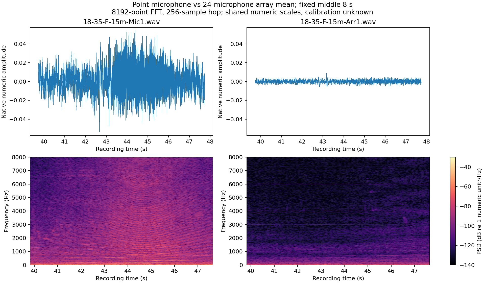
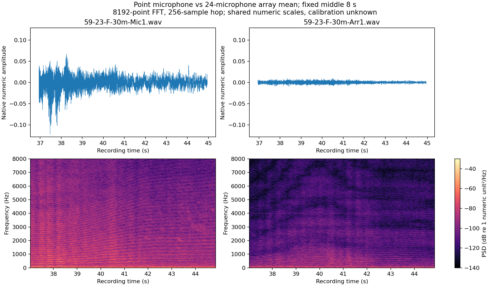

# Completed outdoor intake audit

**The shared intake is complete. Its original outdoor sources provide about
2.94 point-microphone file-hours from one capture campaign, not 11.76 independent
single-microphone hours.** The extra views are averages of microphone arrays.
No model was trained or scored during this audit.

All five completion receipts matched the pinned intake plan, including its
names, byte lengths and source identities. The code pin is
`6d853d9ea2700b03f3a26d2ce81de02f7191c07f`. The shared storage was inspected through
independent HTTPS reads; the catalog and background proof file also matched
their full expected SHA-256 values. The large ZIPs' receipt hashes are now frozen
in [the source lock](../../data/source-lock-v1.json); this executor did not stream
and rehash their entire contents. Private storage IDs/confirmation URLs are not
included in the public artifacts. See [intake verification](intake-verification.json).

## Count timelines and input types

| Source | WAV files | Named measurements | Point-microphone files | Point-file hours |
| --- | ---: | ---: | ---: | ---: |
| Original single-drone outdoor pair |224 |56 |56 |2.8551 |
| Dual-drone pilot |8 |2 |2 |0.0856 |
| Total |232 |58 |58 |2.9407 |

All 224 headers in the main pair were inspected: mono 44.1 kHz IEEE float32, with
matching frame counts across the four views of each measurement. There are 168
array-mean files in that pair and six more in the dual-drone pilot. Counting all
views gives 11.7628 file-hours; it does not multiply elapsed capture time or
independent trials. [Measured groups/durations](summary.json) retain the exact
values and integrity scope.

The [original project report](https://edocs.tib.eu/files/e01fb25/1923886762.pdf),
printed pp. 19–20 and Appendix II, describes three 24-microphone arrays and one BSWA
microphone at the June 7, 2023 Dresden campaign. The array signals were averaged
for classification; individual sensor signals were a separate localization task.
The renamed files' `Arr1/2/3` views therefore differ materially from their `Mic1`
point-microphone view. Likewise the pilot's `Sys1/2/3` differ from `BSWA`.
A mono file is not necessarily an individual microphone recording.

The index retains seven publisher drone codes and condition strings such as
`S-15m`, `F-30m` and `var`. Four codes lack entries in the older public drone table;
we do not invent their model names, interpret every time interval as audible
presence, or equate condition-coded file duration with verified moving-flight
exposure. All recordings remain in one conservative campaign group.

## Inspect native audio before choosing preprocessing

Two pairs were selected deterministically: the shortest point file in each large
archive, paired with its `Arr1` view. All four complete members passed ZIP CRC,
full-member SHA recording, frame/format decoding and finite-sample checks. The
eight pilot members had already passed complete CRC/metadata checks; their
native sample levels were also measured. These checks do not certify every
sample in all 224 recordings.

The two point/array RMS ratios are 8.00 and 12.20. The pilot point/array views also
differ substantially. The report places sensors 30–40 m apart, the array views
average 24 microphones, and cross-recorder calibration has not been established.
Those ratios are not a microphone calibration factor or a controlled gain-only
test. Above-one sample counts are reported without calling them ADC clipping
when physical units/full-scale are unknown. [Native pair metrics](native-pairs.json)
and [pilot levels](multidrone-native-levels.json) retain the measurements.

The figures show the fixed middle eight seconds using the same waveform and
numeric spectral scales. The 8192-point FFT resolves about 5.38 Hz with a 256-sample
hop; only the displayed spectrum is limited to 8 kHz. Original WAVs remain intact.
No normalization, resampling, class scores or semantic listening was used.

## Prepare the correct inputs without losing precision

[Open the CPU point-preparation notebook](https://colab.research.google.com/github/StoneDerek/drone-detection/blob/main/notebooks/prepare_point_recordings.ipynb).
It reads the completed intake and creates a separate 1,867,467,256-byte native
point cache. It excludes array means, preserves each original WAV byte-for-byte,
checks source archive SHA and complete member CRC, and validates finite mono
float samples and frame counts. Source archives stay untouched in Drive;
verified working copies use local SSD one at a time.

The code/environment, source lock and 58-row
[point recording index](../../data/outdoor-point-recordings-v1.jsonl) are pinned.
Completed files have content hashes and receipts; interrupted preparation can
resume without recopying already completed archives' point files. A replaced
runtime rechecks the completed native files. Identity or integrity changes stop
for review. Float samples above numeric one are preserved, not clipped to an
assumed PCM range. The additional Drive allocation is declared by the user, not
inferred from unreliable mounted-drive quota reporting.

A real two-file pilot preserved 54,372,440 bytes exactly and passed a second
fresh-process invocation using completed files. Automated checks also cover
interrupted receipt publication, corrupted outputs, changed archives and array
inputs. [Pilot evidence](preparation-pilot.json) describes its limited scope.
**Full 58-file preparation in Colab has not yet run here.**

## Keep the remaining data problem explicit

The 58 recordings are a source index, not 58 independent capture sessions. Their
publisher recording labels remain weak evidence; audible event boundaries and
reviewed negative stretches are absent. No reviewed drone-absent hours are
established by this release, even though some recordings may contain quiet or
background-only stretches. `null` intervals do not mean verified absence.

The new files remain unassigned to training, calibration or blind evaluation.
A larger negative-only background source cannot by itself supply matched
positive/negative capture conditions. More independently varied field campaigns
and suitable labels remain necessary before the bounded baseline study in
[the research plan](../../docs/research-plan-v2.md). The model's earlier false
alarms have not been repaired by acquiring these files.

Source credit: H2 Think/Fraunhofer IVI AuDroK project. Original-source rights and
terms remain as recorded in the acquisition inventory.
