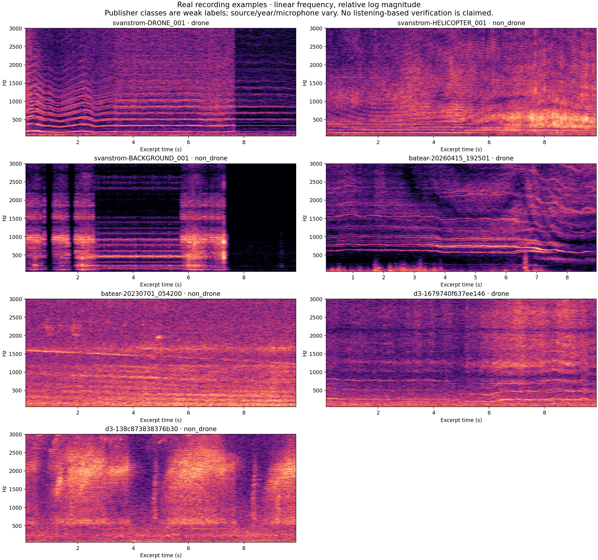

# Specific recordings before a general representation

Seven excerpts were selected by identifiers and source, before inspecting their spectra or choosing successful predictions. All come from existing training/development recordings. The plots are actual audio STFTs. This is a qualitative visual review, not a listening-verified annotation or an accuracy estimate. The five redistributable examples are playable in the Cloudflare interface; local copies of all seven excerpts are under `runs/real-observations-v1/`.

The top panels of each detailed figure show the same high-resolution STFT with a common numerical power reference and with a per-excerpt relative reference. The lower panels show the first three-second CNN input and genuine drone-logit Grad-CAM at conv1. Display scaling is not a claim about calibrated sound pressure. The three numbers in each title are first-context classifier scores, not independently calibrated probabilities or recording-level decisions.

| Specific case | Visible observations | Distinction the formulation needs |
| --- | --- | --- |
| [Svanstrom DRONE_001](svanstrom-DRONE_001.png), first 10 s | Many narrow, approximately parallel bands bend together during the first 3 s, then settle. There is an abrupt broadband level change near 7.7 s. The first-context CNN score is .434, SVM .638, YAMNet .00035. | Relative positions and coordinated trajectories are more descriptive than isolated bright pixels. A visible harmonic stack does not guarantee this trained head recognizes it. The abrupt transition needs provenance/listening review before being called flight behavior. |
| [Svanstrom HELICOPTER_001](svanstrom-HELICOPTER_001.png), first 10 s | Narrow low-frequency bands coexist with a broad, changing concentration around several hundred Hz. | A non-drone rotorcraft also supplies tonal and time-varying structure. “Mechanical harmonics” alone cannot define the target class. |
| [Svanstrom BACKGROUND_001](svanstrom-BACKGROUND_001.png), first 10 s | Strong sustained bands near 1 kHz and at lower frequencies, several abrupt vertical transitions, and a quieter tail. | Background is not synonymous with broadband noise. A detector can exploit recording transitions instead of drone acoustics. These transitions are observations, not proof of editing or mislabelling. |
| [Batear 20260415_192501](batear-20260415_192501.png), 9.08 s | Several closely spaced ridges around 600–900 Hz move together; broadband energy and a vertical transient also vary. The first-context scores are CNN .432, SVM .358, YAMNet .990. | Multiple nearby components and coherent motion may matter. This differs substantially from the Svanstrom comb. A useful formulation must accommodate both without treating every ridge as a drone. |
| [Batear 20230701_054200](batear-20230701_054200.png), first 10 s | A narrow band around 1.5 kHz drifts while low-frequency background varies. | A moving tonal ridge can occur in a publisher-negative recording. This background and the April 2026 positives are different years, not a matched drone-on/drone-off experiment. |
| [D3 ground 1679740f637ee146](d3-1679740f637ee146.png), 98–108 s | Broad low-frequency energy, a low narrow component and faint higher structure; the obvious multi-line comb from DRONE_001 is absent. The first-context YAMNet head still scores .989. | A flight-presence label does not specify audible rotor evidence in this excerpt. Distance, masking, microphone response and a weak label remain competing explanations; this image cannot choose among them. |
| [D3 Insect 138c873838376b30](d3-138c873838376b30.png), first 10 s | Broad, changing concentrations and structured high-frequency sweeps. | Temporal structure and frequency motion are not exclusive to rotors. The negative class needs such structured confounders. |

## What would suggest a drone in sound?

A plausible listening hypothesis is a sustained mechanical buzz/whine with multiple tonal components, beating or roughness, changes shared by several components as rotors change speed, and a coherent rise/fall relative to the background. Rotor blade-passing frequency is approximately blade count × rotations per second; multiple rotors can create nearby families rather than one perfectly regular comb. Doppler and changing load can also move frequencies. These are physical hypotheses to check against listening notes, not criteria established by the seven plots. Helicopters, fans, engines and insects can share parts of the description; no specific fan example was inspected here.

## Are we describing those qualities usefully?

| Quality | Current pipeline | Consequence |
| --- | --- | --- |
| Narrow tonal peaks and spacing | Linear-frequency STFT preserves detail; mel or uniform triangular bands average it. Log intensity compresses amplitude without warping frequency. | A basic STFT contains visibly useful structure in several examples. The log operation itself is not the same as mel frequency averaging. |
| Relationships between separated harmonics | The compact CNN sees only 25 frequency bins before global averaging. At the full 4096 FFT this is about 98 Hz. | An artificial input control reproduced identical scores for different global band arrangements. Finer input does not guarantee a network can compare distant bands. The 256-band CNN has a different physical receptive field; this test is not a proof that all variants erase the same patterns. |
| Coordinated motion over time | Three seconds are retained, but the compact final receptive field is 17 frames (about 0.256 s between first/last frame centers, plus the analysis-window support), followed by global averaging. | The network can react to local motion but cannot generally assemble an arbitrary whole-context trajectory from these local averages. |
| Rapid pulsing/beating | A 256 ms Hann window and 16 ms frame step trade temporal detail for narrow spectral bins. Modulation may remain as spectral sidebands. | A high-resolution magnitude plot is not automatically a good description of rapid envelope modulation. This motivates measurement on examples before adding another input view. |
| Emergence relative to the background | Peak-relative normalization removes a common absolute amplitude factor; within-context spectral contrasts remain. There is no independently measured background or SNR label. | Making every window look bright does not make its rotor component audible. RMS normalization does not remove wind or raise SNR. |
| Source direction | Ingress averages ordinary stereo recordings; D3 array data were separately reduced to one physical microphone channel. | Spatial distinctions are absent from these models. Whether they would help requires suitable recordings, not a larger image. |
| Audible presence and its boundaries | Publisher recording/flight labels, no independently verified audible intervals. Positive training uses a maximum over up to eight sampled windows. | The target can be coarser than the evidence. A selected sub-bag can miss an audible event; the positive gradient can reinforce a coincidental high-scoring window. This is a failure mechanism to investigate, not a demonstrated wrong label for a particular excerpt. |

The next simplified task should be audible drone-on versus drone-off within the same recording setup, with uncertain intervals retained as uncertain and with confounding rotor/tonal sounds. First verify those specific distinctions, then test whether the chosen features and model preserve them, then expand to new sources. The interface exports draft interval notes to support that loop; it does not silently convert them to ground truth or train on them. No multi-view/context branch has been added.

Exact source identifiers, excerpt offsets, file hashes, weak-label status, spectral peak measurements, scores and licenses are in [cases.json](cases.json). Selection and figure generation are reproducible with `scripts/observe_real_audio.py` using matplotlib 3.10.8.
