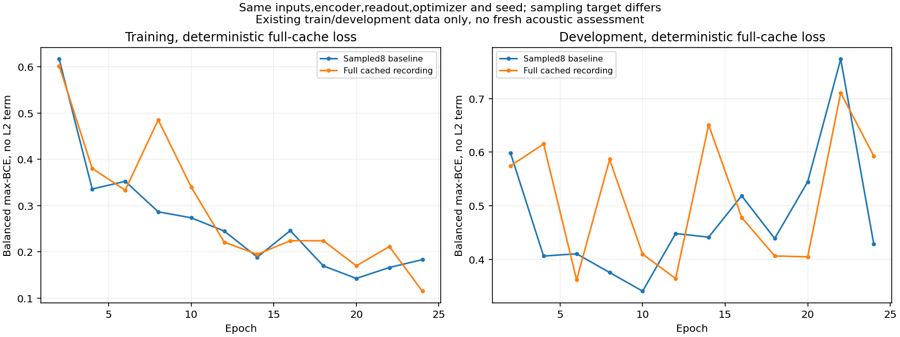

# Remaining training and preprocessing audit

Two concrete issues remain after the earlier dropout-loss repair: sampled sub-bags change the meaning of whole-recording labels, and preparation unnecessarily reduced 15 DDL training recordings from 32-bit PCM to 16-bit PCM. Both now have isolated, reviewable corrections. The controlled training correction did not improve detection recall; neither finding is established as the sole cause of the generalization failures.

The audit opens only the existing 405 training and 210 development recordings. No fresh data, final-assessment audio, new audible labels, architecture search, deployed-model replacement or environment publication is involved.

## 1. Whole-recording labels were applied to sampled sub-bags

The repaired CNN used symmetric BCE of the maximum score for either class, but sampled up to 8 windows per recording at each update. A positive recording guarantees at most that some part contains the event. A sampled subset need not contain it. Conversely, sampling negative windows can omit rare high-scoring confounders. The resulting stochastic objective is not an unbiased estimate of full-recording max-BCE.

For a 60-window recording with one+4 logit and 59−4 logits, full-bag positive loss is 0.0181. Uniform sample 8 misses the rare maximum 86.7% of the time, making expected positive loss 3.4848. For a negative bag with the same scores, full loss 4.0181 falls to expected sampled loss 0.5515. This demonstrates a target discrepancy without claiming that the toy values describe audible event occupancy in real files.

On the frozen selected CNN and all 405 real training recordings, mean positive full-bag loss is 0.1244 versus 0.1517 averaged over its actual cyclic sub-bags; negative loss is 0.4225 versus 0.4091. At these already-trained weights, the observed discrepancy is modest. Frozen model maxima are not audible-window truth. See [complete audit](sampled-objective.json).

The new optional `full_recording_bags=True` training path scans all cached windows in each selected recording, retains all tied maxima, then recomputes those instances with gradients. With dropout 0 and no batch normalization, this gives the full max objective’s gradient without retaining every activation graph. Unsupported stochastic or alternate-pooling modes are rejected. The old experimental paths remain available to reproduce their controls.

An independent per-recording BCE oracle matches the existing loss/gradients on 8 real training recordings. Two-pass selection reduces 179 forwarded contexts to 8 gradient instances, matching full-backpropagation loss within 1.5e-8 and gradients within 4.43e-6. A separate exact-tie test verifies tied gradients are averaged. These are numerical controls, not detection trials.

## 2. DDL precision was unnecessarily reduced

All 615 train/development file origins were checked against retained publisher bytes. 507 files are byte-identical originals; 93 D3 files were already 16-bit PCM and selected the recorded physical channel correctly. The remaining 15 DDL training clips were reconstructed from 32-bit PCM fragments and written as 16-bit PCM.

The DDL conversion introduces up to 0.00003052 absolute sample error. Waveform power relative to conversion-error power ranges from 40.5 to 64.4 dB; this is a quantization measurement, not drone-to-background acoustic SNR. No source clipping was introduced.

Original-precision FLOAT WAV copies now roundtrip exactly at the model’s float32 ingress precision. All 225 cached DDL contexts were compared with the same frozen CNN; maximum score change is 0.007559. This does not establish a large current accuracy effect or rule out loss of faint cues.

`scripts/restore_training_precision.py` creates a separate 615-record train/development manifest with the same labels/splits, replacing only these 15 file references and updating their hashes. The [repair record](precision-repair.json) identifies it. Original corpus files, existing caches and frozen models remain untouched. Future training on this variant requires a new cache/manifest identity. No model was trained on the repaired precision in this audit, so its effect is not mixed with the sampling control.

## Other checks

| Area | Result and qualification |
| --- | --- |
| Decode/resampling and amplitude units | All 615 ingresses agree with float64 channel-mean/polyphase references; correct header rates and sample counts. No common scale/rate error found. |
| Spectrogram cache | All 7,299 tensors exactly match fresh extraction. Independent direct-FFT references on first/middle/last contexts differ by at most 0.000143 on the 0–1 input scale. |
| Axes and transform | Independent periodic-Hann FFT/filterbank implementation plus known-frequency software probes verify frequency/time orientation, FFT sizes, band placement and relative log-power scaling. Probe signals are never training or acoustic accuracy evidence. |
| Normalization | Current CNNs use per-context spectral-peak reference and 80 dB log range, with no shared waveform RMS target. No train/validation normalization-mode mismatch found. |
| Stereo mixing | All 101 stereo files inspected, 301 first/middle/last contexts checked by frequency band. Worst broad-band attenuation is -5.78 dB versus mean channel power; at most 4.29% of spectral energy lies in bins attenuated over 10 dB. This does not rule out narrow harmonic cancellation or establish the best microphone choice. |
| Class mapping, losses and gradients | Raw logits feed BCE once; correct positive/negative signs. Independent per-recording BCE agrees with segment pooling. Current balanced batches have 4 recordings/class and no second class-weight multiplier. No reversed labels, missing gradient or double sigmoid found. |
| Optimizer | Independent first-step Adam calculation matches weights within 1.95e-08. `clipnorm=1` clips each parameter tensor; logged global gradient norms are measured before clipping. This verifies implementation, not that the learning rate is optimal or convergence complete. |
| Training/inference mode | Dropout 0 models produce identical train/inference logits; individual/batched logits differ by at most 1.91e-06 in the checked real batch. No batch-normalization layers exist in these CNNs. |
| Checkpoint selection | All 9 selected/best-at8/last packages for the three current CNNs exactly match their archived epoch arrays. Selected epochs minimize the declared development loss. Calibrated packages preserve those weights. |
| Split isolation | Optimizer inputs are selected only from train records; development inputs are used for checkpoint selection/calibration. All 615 cache identities, sources, labels and original file hashes are checked. Existing weak labels are not independently verified by this audit. |
| Padding and replay | 38 development files have a padded tail. Removing tails changes none of the three current CNNs’ recording alarm outcomes at their original decisions. |
| Context coverage | Uniform validation contains 2,651 contexts versus 12,523 full scored replay contexts. All 12,560 scored dense tensors were freshly re-extracted exactly, including padding, and timestamps checked. The 60-window cap remains a training/product distribution difference. |

## Same-data training control

One seed 42 run changes only instance selection to full cached-recording maxima. The 256×172 frontend, 154,689-parameter frequency readout, original precision/data, initial weights, balanced 4+4 batches, 51 steps/epoch, Adam 0.001/per-tensor clipnorm 1, L2=1e-4, dropout 0 and 24-epoch budget match the sampled baseline. Checkpoints minimize the same deterministic full-cache development max-BCE every 2 epochs. All contexts used for selection count as seen, even though only winners receive classification gradients.

| Model/checkpoint | Epoch | TP /22 | FP /188 | Dense max-score AUC |
| --- | ---: | ---: | ---: | ---: |
| Preserved sampled baseline | 10 | 16 | 9 | 0.941 |
| Full-recording selected/best-at8 | 6 | 14 | 9 | 0.950 |
| Full-recording last | 24 | 15 | 9 | 0.934 |

All alarm thresholds are calibrated on the same reused development data under the 5% negative-file budget. These matching FP counts are a constraint, not independently measured field FPR. The exact-target control improves some ranking measures but detects 14/22 versus 16/22 for the selected sampled baseline. It is not promoted. Late full-target training reduces training loss while development loss deteriorates and oscillates; training dynamics and weak-label generalization are not declared solved.

The audit clears several concrete implementation suspects and identifies two repairable issues. It does not prove the remaining failures are exclusively data-related, that hyperparameters are optimal, or that either repair alone will improve field performance.

## Reproduce and inspect

Run `scripts/audit_audio_frontend.py`, `scripts/audit_source_conversion.py`, `scripts/audit_training_objective.py`, `scripts/audit_cnn_gradients.py`, `scripts/audit_channel_mix.py` and `scripts/audit_context_coverage.py` with the existing corpus/caches. The source-conversion audit uses cached original bytes only; there is no network fallback. Plans and execution snapshots precede the conditional training run. The initial gradient-oracle identity is retained separately from a later correction to per-layer display keys; numerical checks are unchanged.

All 80 Python tests and Ruff pass. The control’s selected/early/last numeric model packages, exact execution code, compressed traces and instance-selection audit are retained under `artifacts/training-audit-v1/` and this report. Original-precision audio remains in ignored `runs/`; no raw publisher recordings are packaged.

For optional local comparison, run `bash scripts/start_lab.sh --catalog reports/training-audit-v1/catalog.json`. The public Cloudflare deployment and existing model packages are unchanged.
